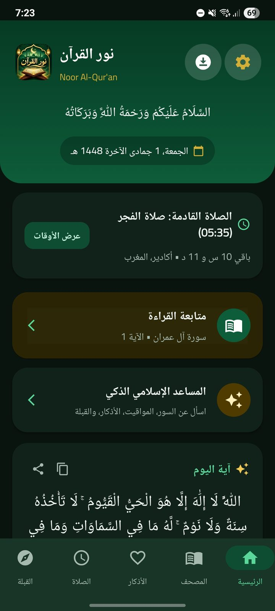
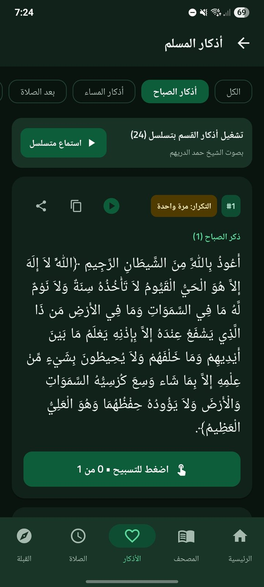
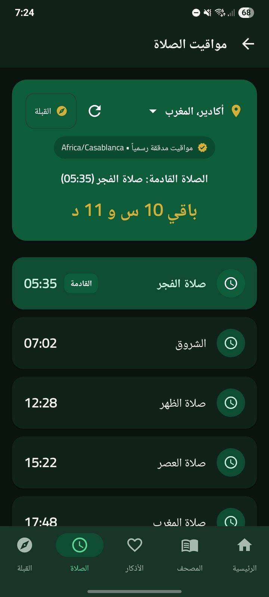
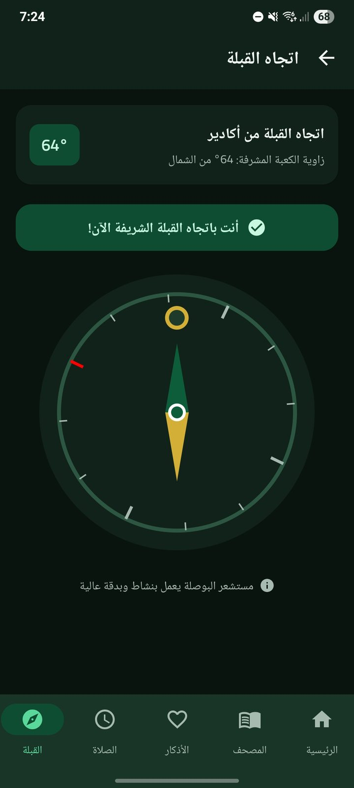

<div align="center">


# نور القرآن · Noor Al-Qur'an

**رفيقك اليومي في رحلتك مع القرآن الكريم**

الموقع الرسمي لتطبيق نور القرآن للأندرويد

[**🌐 زيارة الموقع**](https://noor-al-quran.github.io/nooralquran/) &nbsp;·&nbsp; [**⬇️ تحميل التطبيق**](https://github.com/noor-al-quran/nooralquran/releases/download/v1.0.0/NoorAlQuran.apk)


</div>

<div dir="rtl">

---

## 📖 نبذة

موقع رسمي عربي بالكامل (RTL) يعرّف بتطبيق **نور القرآن** ويعرض خدماته بلقطات شاشة حقيقية من التطبيق، بهوية بصرية زمردية وذهبية مستوحاة من الزخارف الإسلامية.

التطبيق يجمع في مكان واحد: القرآن الكريم، التلاوات، الأذكار، مواقيت الصلاة، اتجاه القبلة، المسبحة الإلكترونية، أسماء الله الحسنى، موسوعة الحديث، التقويم الهجري، والمساعد الإسلامي الذكي.

---

## ✨ مميزات الموقع

- **15 صفحة** مستقلة بتصميم متناسق، تعمل على GitHub Pages دون إعدادات خاصة (تنقل بالهاش).
- **معرض صور تفاعلي** بإطارات هواتف، وتصنيف حسب الميزة، وتكبير بالضغط، وتنقل بالأسهم ولوحة المفاتيح.
- **17 لقطة حقيقية** من التطبيق، محسّنة (عرض 720px) مع تحميل كسول (Lazy Loading).
- **تصميم متجاوب** يركّز على تجربة الهاتف.
- **حركات خفيفة**: ظهور عند التمرير، تأثيرات Hover، خلفيات زخرفية، وتحترم إعداد «تقليل الحركة».
- **معاينة مشاركة** جاهزة لواتساب وفيسبوك وتيليجرام (Open Graph).
- **أيقونة موقع** (favicon) وأيقونات للأجهزة.
- **نشر تلقائي** عبر GitHub Actions عند كل تحديث.

---

## 🗂️ صفحات الموقع

| الصفحة | المسار |
|---|---|
| الرئيسية | `#/` |
| عن التطبيق | `#/about` |
| القرآن الكريم | `#/quran` |
| التلاوات والقراء | `#/reciters` |
| الأذكار | `#/adhkar` |
| مواقيت الصلاة | `#/prayer` |
| اتجاه القبلة | `#/qibla` |
| المسبحة الإلكترونية | `#/tasbih` |
| أسماء الله الحسنى | `#/names` |
| موسوعة الحديث | `#/hadith` |
| المساعد الإسلامي | `#/assistant` |
| التقويم الهجري | `#/calendar` |
| التنزيلات والإعدادات | `#/offline` |
| معرض الصور | `#/gallery` |
| الخصوصية | `#/privacy` |
| عن المطور | `#/developer` |

---

## 🖼️ لقطات من التطبيق

<div align="center">




</div>

---

## 🧰 التقنيات

| التقنية | الاستخدام |
|---|---|
| React 18 + TypeScript | بناء الواجهة بمكونات قابلة لإعادة الاستخدام |
| Vite | التطوير السريع والبناء |
| Tailwind CSS | التصميم والهوية البصرية |
| Framer Motion | الحركات والانتقالات |
| Lucide React | الأيقونات |
| GitHub Actions + Pages | النشر التلقائي |

**الهوية البصرية:** زمردي `#0D5C3A` · أخضر داكن `#063A23` · ليلي `#0A140F` · ذهبي `#D4AF37` · كريمي `#FAF7EE` — بخطّي **Cairo** للواجهة و**Amiri** للنصوص القرآنية.

---

## 📁 بنية المشروع

```text
├── .github/workflows/deploy.yml   # النشر التلقائي
├── public/
│   ├── images/logo.jpg            # شعار التطبيق
│   ├── images/shots/              # لقطات الشاشة (17)
│   ├── og-image.jpg               # صورة معاينة المشاركة (1200×630)
│   └── favicon.ico, icon-192.png, apple-touch-icon.png ...
├── src/
│   ├── App.tsx                    # التوجيه (hash routing)
│   ├── data.ts                    # محتوى الصفحات واللقطات
│   ├── index.css                  # الأنماط العامة
│   └── components/                # Hero, Home, Pages, Navbar, Footer, Lightbox, ui
├── index.html                     # وسوم SEO وOpen Graph
├── vite.config.ts
└── tailwind.config.js
```

---

## 🚀 التشغيل محلياً

```bash
npm install
npm run dev        # تشغيل محلي
npm run build      # بناء للإنتاج (مجلد dist)
npm run preview    # معاينة نسخة الإنتاج
```

يتطلب Node.js 18 أو أحدث.

---

## 🌍 النشر على GitHub Pages

1. ارفع المشروع إلى مستودع على GitHub (الفرع `main`).
2. من **Settings ← Pages** اختر **Source: GitHub Actions**.
3. أي `push` على `main` يبني الموقع وينشره تلقائياً عبر `.github/workflows/deploy.yml`.

مسار الموقع يؤخذ تلقائياً من اسم المستودع (`VITE_BASE`). وللبناء المحلي بمسار مخصص:

```bash
VITE_BASE=/اسم-المستودع/ npm run build
```

> 💡 كل `push` يطلق نشراً كاملاً؛ انتظر ✅ في تبويب **Actions** قبل إجراء تعديل آخر.

---

## 📲 تحديث ملف التطبيق (APK)

زر «تحميل التطبيق» يشير دائماً إلى **أحدث إصدار**، فلا حاجة لتعديل الكود عند التحديث:

1. افتح **Releases ← Draft a new release**.
2. أنشئ وسماً جديداً (مثل `v1.0.1`).
3. ارفع ملف التطبيق باسم **`NoorAlQuran.apk`** تماماً.
4. اضغط **Publish release**.

الرابط الثابت:

```text
https://github.com/noor-al-quran/nooralquran/releases/download/v1.0.0/NoorAlQuran.apk
```

الرابط معرّف في `src/components/Hero.tsx` (الثابت `APK_URL`).

---

## ✏️ تعديل المحتوى

| المطلوب | الملف |
|---|---|
| نصوص الصفحات والنقاط | `src/data.ts` ← `PAGES` |
| لقطات الشاشة ووصفها | `src/data.ts` ← `SHOTS` + `public/images/shots/` |
| الصفحة الرئيسية | `src/components/Hero.tsx` و`Home.tsx` |
| سياسة الخصوصية | `src/components/Pages.tsx` ← `PrivacyPage` |
| الألوان والخطوط | `tailwind.config.js` و`index.html` |

---

## 🔗 معاينة المشاركة (Open Graph)

- صورة المعاينة: `public/og-image.jpg` بأبعاد **1200×630** وبحجم **أقل من 300KB** (شرط عملي لظهورها في واتساب).
- الوسوم موجودة في `index.html`، وروابط الصورة فيها **مطلقة** (`https://...`).
- واتساب يحفظ المعاينة لكل رابط؛ عند تغيير الصورة اختبر برابط يحمل معاملاً جديداً مثل `?v=2`.

---

## 📝 ملاحظات

- صفحة **الخصوصية** قالب أولي، ويُستكمل بالصياغة المعتمدة قبل الاعتماد عليها.
- قسم **المساعد الذكي** تعريفي فقط؛ الموقع لا يتصل بأي خدمة ذكاء اصطناعي.
- لقطات الشاشة حقيقية من التطبيق، ولا تُستبدل بصور مولّدة.

---

## 👨‍💻 المطور

**حمزة أملال** — مطور ومهتم ببرمجة المواقع والتطبيقات والبرمجيات، وأسعى إلى تقديم تجارب رقمية تجمع بين الجودة التقنية والفائدة.

</div>

<div align="center">

© 2026 نور القرآن · Noor Al-Qur'an

</div>
